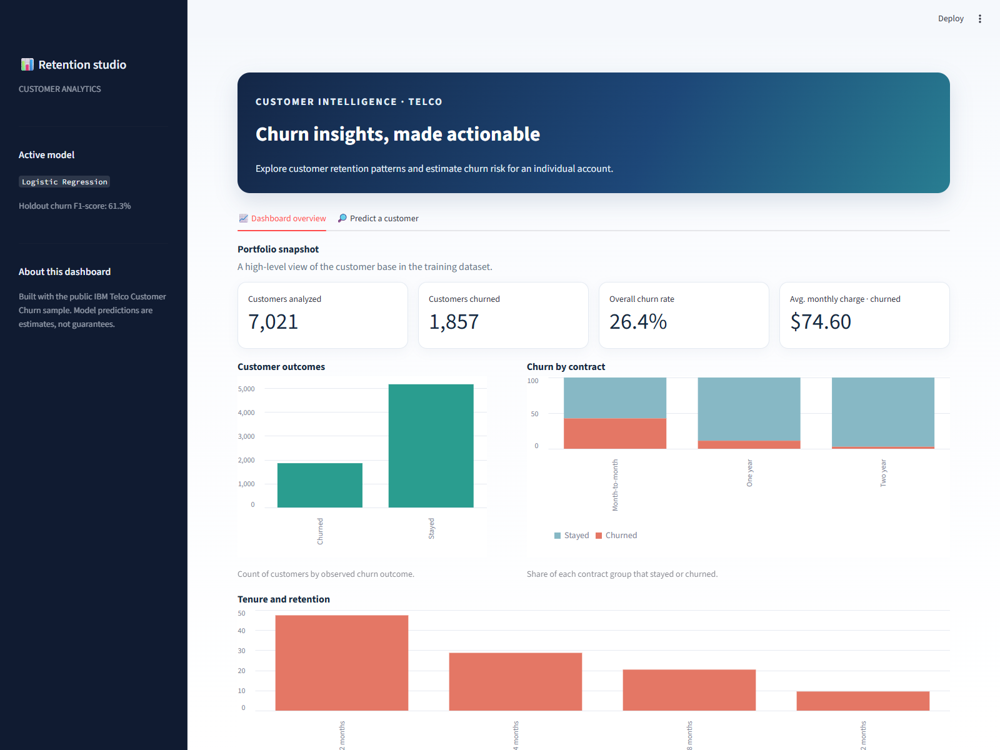

# Customer Churn Prediction

A beginner-friendly Python project that uses the public IBM Telco Customer Churn
dataset to predict whether a customer may leave. Pandas and NumPy clean the data;
Scikit-learn trains Logistic Regression and Random Forest models; Streamlit provides
an interactive dashboard with portfolio visualizations and individual customer predictions.

> **Use note:** This is an educational example. Predictions are estimates and should
> not be treated as certain outcomes or used as the sole basis for customer decisions.

## Project structure

```text
customer-churn-prediction/
├── app.py                         # Streamlit churn dashboard and prediction form
├── data_preprocessing.py          # Download, validate, and clean the dataset
├── train.py                       # Train both classifiers and save holdout data
├── evaluate.py                    # Report metrics and select the best model
├── requirements.txt               # Python dependencies
├── screenshots/
│   └── dashboard.png               # Dashboard overview screenshot
├── data/
│   ├── raw/.gitkeep                # Downloaded source CSV is created here
│   └── processed/.gitkeep          # Cleaned CSV is created here
├── models/
│   └── .gitkeep                    # Trained joblib files are created here
├── reports/
│   └── .gitkeep                    # Evaluation metrics are created here
├── src/
│   ├── __init__.py                 # Marks src as a Python package
│   └── train.py                    # Compatibility wrapper for root train.py
└── .gitignore                      # Excludes generated data, models, and caches
```

## Setup and run

Use Python 3.10 or newer. From the project root:

```powershell
py -m venv .venv
.\.venv\Scripts\Activate.ps1
python -m pip install -r requirements.txt
python data_preprocessing.py
python train.py
python evaluate.py
streamlit run app.py
```

`train.py` can also create the cleaned dataset automatically if preprocessing has
not been run. Evaluation should be run after training; it selects the model with the
highest F1-score for customers who churn ("Yes"). The app then uses that selected
model. Generated datasets, models, and reports are ignored by Git and can be
recreated by repeating these commands.

## Application screenshot



## What each file does

### `data_preprocessing.py`

- Defines the public CSV URL and project-relative paths for raw and cleaned data.
- `load_raw_dataset()` reads a cached local CSV or downloads and caches the public
  IBM Telco dataset.
- `clean_dataset()` checks required columns, selects the model features and churn
  target, converts `TotalCharges` to numeric (invalid/blank values become missing),
  changes infinite numeric values to missing with NumPy, and filters invalid labels.
  It preserves rows with identical feature values because distinct customers can
  have the same profile.
- `load_or_create_clean_dataset()` lets training reuse the processed CSV, or create
  it if it is not present.
- Running the file directly saves `data/processed/telco_customer_churn_clean.csv`.
  The `customerID` identifier is excluded because it is not a useful customer
  behavior feature.

### `train.py`

- Imports the shared feature definitions and cleaned data loader from
  `data_preprocessing.py`.
- `build_preprocessor()` uses median imputation and standard scaling for numeric
  fields, and most-frequent imputation and one-hot encoding for categories.
  `handle_unknown="ignore"` allows the app to accept categories that were not in
  the training split.
- `train_test_split()` reserves 20% for evaluation, preserves the class balance
  with stratification, and uses `random_state=42` for repeatable results.
- Two Scikit-learn pipelines train Logistic Regression and Random Forest using the
  same preprocessing. Balanced class weights help account for fewer churn examples.
- Saves both fitted candidates to `models/churn_models.joblib`; saves the fixed
  holdout data to `models/evaluation_data.joblib` so the metrics compare the same
  unseen records. It also writes an initial model artifact for the app; `evaluate.py`
  replaces it with the F1-score winner.
- `src/train.py` remains as a compatibility wrapper for the earlier
  `python -m src.train` command.

### `evaluate.py`

- Loads both saved pipelines and the holdout features/labels created by `train.py`.
- Calculates accuracy, precision, recall and F1-score for the churn-positive class.
- Prints a confusion matrix with `No`, `Yes` row and column order (true class by
  predicted class).
- Writes both models' scores to `reports/metrics.json`.
- Chooses the model with the higher churn F1-score and saves it to
  `models/churn_model.joblib`, which is the artifact the app loads.

### `app.py`

- Loads the selected joblib pipeline and local customer data, and displays a clear
  setup message if training or evaluation has not created the required files.
- The **Dashboard overview** tab shows customer count, churn count and rate, average
  monthly charges for churned customers, and visualizations of churn outcomes,
  contract churn rates, and churn rate by tenure.
- The **Predict a customer** tab presents customer fields matching the training
  feature names and types. It builds a one-row Pandas DataFrame, predicts churn,
  and displays the result and estimated churn probability.
- Uses Streamlit's cached data and model loading to avoid rereading files on every
  interaction. Charts summarize the sample dataset and are not live business data.

### `requirements.txt`

Lists Pandas and NumPy for data preparation, Scikit-learn for machine learning,
joblib for model persistence, and Streamlit for the web app. Use
`python -m pip install -r requirements.txt` to install them.

## Dataset and limitations

This project uses the public IBM Telco Customer Churn sample dataset. The CSV is
fetched from a [public dataset copy](https://raw.githubusercontent.com/arghac14/Customer-Churn-Analysis/master/Decision%20Tree/WA_Fn-UseC_-Telco-Customer-Churn.csv).
The holdout scores describe this dataset and split, not guaranteed performance on
future customers. Review recall, precision, class balance, and the confusion matrix
before interpreting predictions. The model is not validated for consequential
real-world decisions.

## Publish this project on GitHub

GitHub repository URLs cannot contain spaces. Use `customer-churn-prediction` as
the repository slug; the README title can remain **Customer Churn Prediction**.

1. Sign in at [GitHub](https://github.com/new) and create a repository named
   `customer-churn-prediction`. Choose Public or Private, and create it without
   adding a README, license, or `.gitignore` (this project already has a README and
   `.gitignore`).
2. From this project folder, initialize Git and push the project. Replace
   `<YOUR-USERNAME>` with your GitHub username or organization:

   ```powershell
   git init -b main
   git add .
   git commit -m "Add customer churn prediction dashboard"
   git remote add origin https://github.com/<YOUR-USERNAME>/customer-churn-prediction.git
   git push -u origin main
   ```

3. Open the repository page. GitHub renders this README and its dashboard screenshot
   automatically. The dataset, trained models, and generated reports are excluded
   from the upload by `.gitignore`; they can be recreated using the setup commands.
